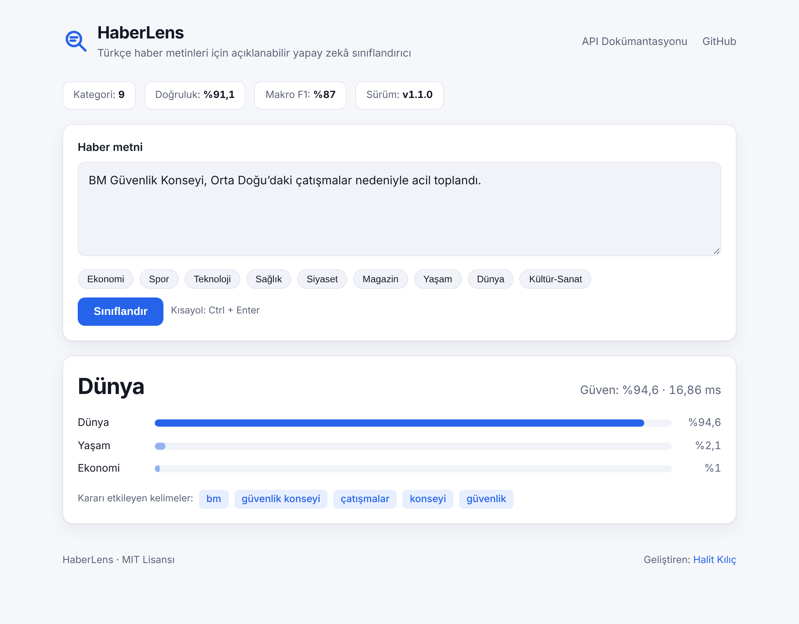
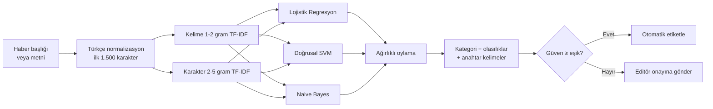

<div align="center">

# 🔎 HaberLens

**Türkçe haberler için açıklanabilir, üretime hazır yapay zekâ sınıflandırıcı**

Bir haberi (başlık ya da tam metin) milisaniyeler içinde **9 kategoriden** birine atar,<br>
kararını **hangi kelimelere dayanarak** verdiğini gösterir ve emin olmadığında **editöre haber verir**.

[](https://github.com/kilicchalitt/haberlens/actions/workflows/ci.yml)


[](LICENSE)

[Hızlı Başlangıç](#-hızlı-başlangıç) •
[Kullanım](#-kullanım) •
[Performans](#-performans) •
[Mimari](docs/ARCHITECTURE.md) •
[API](docs/API.md) •
[Model Kartı](docs/MODEL_CARD.md) •
[Deneyler](docs/EXPERIMENTS.md) •
[English](#-english-summary)

<picture>
  <source media="(prefers-color-scheme: dark)" srcset="docs/assets/web-ui-dark.png">
  
</picture>

</div>

---

## ✨ Neden HaberLens?

Haber siteleri, medya takip ajansları ve kurumsal iletişim ekipleri her gün yüzlerce
haberi elle kategorilere ayırır. HaberLens bu işi otomatikleştirir; ama bir kara kutu
gibi değil, **gerekçesini göstererek** ve **emin olmadığını söyleyerek**.

| | Özellik | Açıklama |
| :-: | --- | --- |
| 🌐 | **Her kaynağa genellenir** | Üç farklı kaynaktan 30 bin haberle eğitildi; eğitimde **hiç görmediği** yayın organlarında ayrıca test edildi |
| 🎯 | **Ölçülmüş başarı** | 9 kategoride %91,1 doğruluk; doğru kategori %97,5 oranında ilk iki öneri arasında |
| 🧠 | **Model topluluğu** | Lojistik Regresyon, Doğrusal SVM ve Naive Bayes'in ağırlıklı oylaması; kısa başlıklarda ve ilk-2 önerilerde en iyi sonuç |
| 💡 | **Açıklanabilir** | Her tahmin, karara en çok katkı veren kelimelerle gelir (*"merkez bankası", "faiz" → Ekonomi*) |
| 🙋 | **İnsan-döngüde** | Düşük güvenli tahminler `uncertain` olarak işaretlenir ve editör onayına yönlendirilebilir |
| 📰 | **Başlık ya da tam metin** | Başlık artırımıyla eğitildi; yalnızca başlık gönderildiğinde de çalışır |
| 🇹🇷 | **Türkçeye özgü** | `I/İ` dönüşümü, kesme işaretli ekler (*Fed'in → fed*), karakter n-gramlarıyla ek yapısına dayanıklılık |
| ⚡ | **GPU gerektirmez** | Tekil tahmin ~8 ms, toplu işlemde saniyede ~7.000 haber |
| 🔌 | **Her yerden erişim** | Web arayüzü, REST API, komut satırı, CSV toplu işlem ve Python kütüphanesi |
| 🏢 | **Kuruma uyarlanabilir** | Kendi arşivinizle tek komutla yeniden eğitin, kendi etiketli verinizle ölçün |
| 🔒 | **Üretime hazır** | API anahtarı, CORS, istek sınırları, sağlık kontrolü, Docker, CI, %97 test kapsamı |

### Kategoriler

| Kategori | Kapsam |
| --- | --- |
| **Dünya** | Dış haberler, uluslararası ilişkiler ve kuruluşlar |
| **Ekonomi** | Piyasalar, para politikası, şirketler, enflasyon |
| **Kültür-Sanat** | Sinema, tiyatro, müzik, edebiyat, sergiler |
| **Magazin** | Ünlüler, dizi ve eğlence dünyası |
| **Sağlık** | Hastalıklar, tedavi, sağlık politikaları, beslenme |
| **Siyaset** | İç politika, meclis, partiler, seçimler |
| **Spor** | Futbol başta olmak üzere tüm spor dalları |
| **Teknoloji** | Yazılım, donanım, internet, bilim-teknoloji |
| **Yaşam** | Asayiş, kazalar ve doğal afetler |

## 🚀 Hızlı Başlangıç

### Docker ile (önerilen)

```bash
git clone https://github.com/kilicchalitt/haberlens.git
cd haberlens
docker compose up --build
```

İlk derleme eğitim derlemini (~80 MB) indirip doğrular ve modeli eğitir (~15 dakika).
Ardından **http://localhost:8000** adresini açın. API dokümantasyonu: **http://localhost:8000/docs**

### pip ile

```bash
git clone https://github.com/kilicchalitt/haberlens.git
cd haberlens
python -m venv .venv && source .venv/bin/activate   # Windows: .venv\Scripts\activate
pip install -e ".[api]"

haberlens data build   # 3 kaynağı indirir, doğrular ve birleştirir → data/processed/
haberlens train        # ~13 dk (4 çekirdek) → models/haberlens.joblib
haberlens serve        # http://127.0.0.1:8000
```

> TTC-3600 kaynağı RAR arşividir; Linux'ta `libarchive-tools` paketi gerekir (macOS ve
> Windows 10+'da yerleşik `tar` yeterlidir). Araç yoksa derleme bu kaynağı atlayarak devam eder.

## 📖 Kullanım

### 1. Web arayüzü

`haberlens serve` komutundan sonra tarayıcıdan metni yapıştırın; kategori, olasılıklar ve
kararı etkileyen kelimeler anında görünür. Açık/koyu tema ve mobil uyumludur.

### 2. Komut satırı

```console
$ haberlens predict "BM Güvenlik Konseyi, Orta Doğu’daki çatışmalar nedeniyle acil toplandı"

📰 BM Güvenlik Konseyi, Orta Doğu’daki çatışmalar nedeniyle acil toplandı
   → Dünya  (%94,6)
     Yaşam      %2,1
     Ekonomi    %1,0
   Anahtar kelimeler: bm, güvenlik konseyi, çatışmalar, konseyi, güvenlik
```

**Toplu işlem:** Bir kurumun günlük haber akışını tek komutla sınıflandırın:

```console
$ haberlens predict --file gunluk_haberler.csv --text-column baslik --output sonuc.csv
1250 metin sınıflandırıldı → sonuc.csv
İnsan onayı önerilen (düşük güvenli) kayıt: 18
```

Çıktı dosyasına `predicted_label`, `confidence` ve `uncertain` sütunları eklenir.
`.txt` (satır başına bir haber) girdi ve `.jsonl` çıktı da desteklenir.

<details>
<summary><b>Tüm komutlar</b></summary>

| Komut | Açıklama |
| --- | --- |
| `haberlens data build` | Çok kaynaklı eğitim derlemini indirir, doğrular ve oluşturur |
| `haberlens train` | Modeli eğitir, ayrılmış test kümesinde ölçer, sürümlü model dosyası üretir |
| `haberlens predict` | Argüman, stdin veya dosyadan gelen metinleri sınıflandırır (`--json` destekli) |
| `haberlens evaluate --data test.csv` | Kayıtlı modeli kurumun kendi etiketli verisiyle ölçer |
| `haberlens info` | Model kartını (mimari, tarih, metrikler) gösterir |
| `haberlens benchmark` | Mimarileri ayrılmış test ve görülmemiş kaynak testinde karşılaştırır |
| `haberlens serve` | REST API ve web arayüzünü başlatır |

</details>

### 3. REST API

```bash
curl -X POST http://localhost:8000/v1/classify \
  -H "Content-Type: application/json" \
  -d '{"text": "Merkez Bankası politika faizini sabit tuttu"}'
```

```json
{
  "label": "Ekonomi",
  "confidence": 0.9836,
  "scores": { "Ekonomi": 0.9836, "Magazin": 0.0084, "Yaşam": 0.0025 },
  "uncertain": false,
  "keywords": [
    { "term": "merkez bankası", "weight": 0.5243 },
    { "term": "bankası", "weight": 0.4096 },
    { "term": "merkez", "weight": 0.2391 }
  ],
  "processing_ms": 8.1
}
```

Toplu sınıflandırma (`/v1/classify/batch`), kimlik doğrulama ve hata kodları için
[API referansına](docs/API.md) bakın.

### 4. Python kütüphanesi

```python
from haberlens import NewsClassifier

clf = NewsClassifier.load("models/haberlens.joblib")

result = clf.predict("Yapay zekâ destekli yeni akıllı telefon tanıtıldı")
print(result.label, result.confidence)            # Teknoloji 0.9907
print([k.term for k in result.keywords])          # ['akıllı', 'yapay', 'tanıtıldı', ...]

for r in clf.predict_batch(["Borsa düştü", "Derbi berabere bitti"]):
    print(r.label, r.uncertain)                   # Ekonomi False / Spor True
```

## 🏢 Kurumsal Kullanım Senaryoları

| Kurum | Senaryo |
| --- | --- |
| **Haber siteleri / CMS** | Editör haberi girerken kategori önerisi; yanlış kategoride yayınlanan haberlerin tespiti |
| **Medya takip ajansları** | Günlük binlerce haberi müşteri ilgi alanlarına göre otomatik yönlendirme |
| **Kurumsal iletişim / PR** | Kurum hakkında çıkan haberlerin konu bazlı raporlanması |
| **Arşiv ve kütüphaneler** | Etiketsiz eski haber arşivlerinin toplu etiketlenmesi |
| **Araştırmacılar / öğrenciler** | Türkçe metin sınıflandırma için tekrarlanabilir referans uygulama |

### Kendi verinizle eğitim ve ölçüm

Kurumunuzun kendi kategorileri mi var? İki sütunlu herhangi bir CSV yeterli:

```bash
haberlens train --data kurum_arsivi.csv --text-column baslik --label-column kategori
haberlens evaluate --data kurum_test_seti.csv --text-column baslik --label-column kategori
```

`evaluate`, makro F1'i yalnızca sizin verinizde bulunan kategoriler üzerinden hesaplar ve
`KAYNAK` sütunu varsa sonuçları kaynak bazında da raporlar.

## 📊 Performans

Model, birbirinden bağımsız üç kaynaktan derlenen **30.435 benzersiz haberle**
eğitilmiştir: kısa başlıklar (haberlens) ve farklı yayın organlarından tam metin haberler
(YTÜ Kemik 42K, TTC-3600). Ayrıntılar: [`data/README.md`](data/README.md).
Tüm sonuçlar `haberlens benchmark` ile yeniden üretilebilir.

### Ayrılmış test kümesi

Katmanlı %80 / %20 bölme; tüm mimariler aynı veride, aynı koşullarda.

| Sıra | Yöntem | Doğruluk | Makro F1 | İlk-2 doğruluk | Başlık F1¹ |
| :-: | --- | :-: | :-: | :-: | :-: |
| 1 | Hibrit + Lojistik Regresyon | %91,18 | %87,16 | %97,59 | %78,51 |
| 2 | Hibrit + Doğrusal SVM | %91,19 | %87,16 | %97,26 | %78,88 |
| 3 | **HaberLens Ensemble** (LR + SVM + NB) | %91,08 | %86,98 | %97,54 | %79,80 |
| 4 | TF-IDF | %90,44 | %86,12 | %97,08 | %76,94 |
| 5 | Karakter n-gram | %90,37 | %85,98 | %97,04 | %76,99 |
| 6 | Bag-of-Words | %89,39 | %84,60 | %96,44 | %74,81 |
| 7 | Hibrit + Naive Bayes | %90,08 | %84,60 | %97,06 | %78,42 |
| 8 | Word2Vec (ortalama vektör) | %87,96 | %82,56 | %95,88 | %73,34 |
| 9 | N-Gram (bigram) | %85,92 | %79,27 | %92,69 | %64,32 |

¹ Uzun test haberlerinin yalnızca ilk 12 kelimesi verildiğinde (başlık benzeri kısa girdi) makro F1.

### Görülmemiş kaynak testi

Gerçek dünyadaki asıl soru şu: *Model, eğitimde hiç görmediği bir sitenin haberlerinde ne
kadar başarılı?* Bunun için her kaynak sırayla eğitimden **tamamen çıkarılır** ve model
yalnızca o kaynakta test edilir (makro F1):

| Yöntem | → haberlens<br/><sub>başlıklar</sub> | → Kemik 42K<br/><sub>tam metin</sub> | → TTC-3600<br/><sub>tam metin</sub> | Ortalama |
| --- | :-: | :-: | :-: | :-: |
| Hibrit + Lojistik Regresyon | %86,9 | %77,9 | %88,9 | **%84,6** |
| Hibrit + Doğrusal SVM | %87,4 | %78,8 | %90,0 | **%85,4** |
| Hibrit + Naive Bayes | %84,2 | %77,5 | %86,5 | **%82,7** |
| **HaberLens Ensemble** (LR + SVM + NB) | %87,5 | %78,7 | %89,6 | **%85,3** |

### v1.0 → v1.1: neden önemli?

v1.0 tek bir veri setiyle eğitilmişti ve kendi test verisinde %98,5 makro F1 veriyordu;
ancak **başka bir yayın organının** haberlerinde başarısı ölçüldüğünde tablo değişiyordu:

| Görülmemiş kaynak | v1.0 (tek kaynak) | v1.1 (çok kaynak + topluluk) | Fark |
| --- | :-: | :-: | :-: |
| Kemik 42K (tam metin) | %76,5 | %78,7 | **+2,2** puan |
| TTC-3600 (tam metin) | %85,2 | %89,6 | **+4,4** puan |

v1.1'in ayrılmış test skoru daha düşük görünür, çünkü görev daha zordur: 9 kategori, başlık
ve tam metin karışık, birden çok yayın organı. Buna karşılık model **hiç görmediği
kaynaklarda 2-4 puan daha başarılıdır**; bir kurumun kendi haberlerine uygulandığında
belirleyici olan budur. (v1.1 sütununda test edilen kaynak eğitimden tamamen çıkarılmıştır;
Kemik testinde model yalnızca ~6 bin haberle eğitilmiş olmasına rağmen v1.0'ı geçer.) Ölçümler ve her kararın gerekçesi:
[`docs/EXPERIMENTS.md`](docs/EXPERIMENTS.md).

**Önemli bulgular**

- **Veri çeşitliliği, model seçiminden daha etkili.** Tek kaynaklı model görülmemiş kaynakta
  ~22 puan kaybediyordu.
- **Model seçimi ikinci planda.** Başlık artırımıyla birlikte LR, SVM ve topluluk birbirine
  1 puan yakın. Topluluk kısa başlıklarda ve ilk-2 doğrulukta önde; `--architecture svm`
  eşdeğer doğrulukla daha hafif bir seçenek.
- **Başlık artırımı kısa girdilerde fark yaratıyor.** Görülmemiş kaynağın başlıklarında
  +4,4 puan makro F1.
- **Karakter n-gramları Türkçe için kritik.** *ekonomi / ekonomik / ekonomide* gibi
  çekimleri kök bulucu olmadan yakalar.

Sınıf bazlı metrikler, karışıklık matrisi ve sınırlamalar: [Model Kartı](docs/MODEL_CARD.md)

## 🏗 Mimari



Ön işleme, öznitelik çıkarımı ve sınıflandırıcılar tek bir scikit-learn `Pipeline` içinde
yer alır; böylece veri sızıntısı yapısal olarak engellenir ve model tek dosya olarak
sürümlenir. Ayrıntılar ve tasarım kararları: [docs/ARCHITECTURE.md](docs/ARCHITECTURE.md)

## ⚙️ Yapılandırma

Tüm ayarlar ortam değişkenleriyle yapılır (bkz. [`.env.example`](.env.example)):

| Değişken | Varsayılan | Açıklama |
| --- | --- | --- |
| `HABERLENS_MODEL_PATH` | `models/haberlens.joblib` | Yüklenecek model dosyası |
| `HABERLENS_DATA_PATH` | `data/processed/news_corpus.csv` | Varsayılan eğitim verisi |
| `HABERLENS_API_KEY` | *(boş)* | Tanımlanırsa `/v1/*` uç noktaları `X-API-Key` ister |
| `HABERLENS_CORS_ORIGINS` | *(boş)* | Virgülle ayrılmış izinli kaynaklar |
| `HABERLENS_MAX_BATCH_SIZE` | `256` | Toplu istekte en fazla metin sayısı |
| `HABERLENS_MAX_TEXT_LENGTH` | `20000` | Tek metnin en fazla karakter sayısı |

**Kaynak gereksinimi:** Model dosyası ~96 MB'tır; her sunucu işlemi (worker) ~450 MB bellek
kullanır. Docker imajı varsayılan olarak 2 işlemle çalışır (~1 GB). Kaynağı kısıtlı ortamlar
için `haberlens train --architecture svm` eşdeğer doğrulukta daha hafif bir model üretir
(22 MB dosya, işlem başına ~370 MB bellek).

## 📁 Proje Yapısı

```text
haberlens/
├── src/haberlens/
│   ├── corpus.py          # Çok kaynaklı derlem: indirme, doğrulama, eşleme, temizlik
│   ├── preprocessing.py   # Türkçeye özgü metin normalizasyonu
│   ├── data.py            # Veri yükleme, doğrulama, kategori × kaynak katmanlı bölme
│   ├── pipelines.py       # Mimariler: bow, tfidf, bigram, char, hybrid, svm, nb, ensemble
│   ├── training.py        # Başlık artırımı, eğitim, değerlendirme, model kaydı
│   ├── evaluation.py      # Metrikler: makro F1, ilk-2, kaynak bazlı, başlık performansı
│   ├── artifact.py        # Sürümlü model dosyası + JSON model kartı
│   ├── predictor.py       # NewsClassifier: tahmin, belirsizlik, açıklama
│   ├── benchmark.py       # Ayrılmış test + görülmemiş kaynak karşılaştırması
│   ├── embeddings.py      # İsteğe bağlı Word2Vec (benchmark)
│   ├── cli.py             # `haberlens` komut satırı aracı
│   └── api/               # FastAPI uygulaması ve web arayüzü
├── tests/                 # 118 test, %97 kapsam
├── data/                  # Özgün veri seti ve veri kartı (indirilen veriler git dışında)
├── docs/                  # Mimari, API, model kartı, deney günlüğü, yol haritası
├── reports/               # Benchmark sonuçları
├── Dockerfile · docker-compose.yml · Makefile · pyproject.toml
└── .github/               # CI, Dependabot, issue/PR şablonları
```

## 🧪 Geliştirme

```bash
make dev        # geliştirme bağımlılıkları
make test       # pytest + kapsam raporu
make lint       # ruff kontrolleri
make help       # tüm komutlar
```

Katkı rehberi için [CONTRIBUTING.md](CONTRIBUTING.md), güvenlik politikası için
[SECURITY.md](SECURITY.md) dosyalarına bakın.

## 🗺 Yol Haritası

- [x] **v1.0:** Açıklanabilir model, CLI, REST API, web arayüzü, Docker, CI
- [x] **v1.1:** Çok kaynaklı derlem, 9 kategori, model topluluğu, görülmemiş kaynak testi
- [ ] Editör geri bildirimi toplama ve periyodik yeniden eğitim
- [ ] Prometheus metrikleri ve hız sınırlama
- [ ] İnce ayarlı Türkçe transformer (BERT) + ONNX ile hızlı çıkarım
- [ ] Çoklu etiket ve kategori dışı haber tespiti

Ayrıntılar: [docs/ROADMAP.md](docs/ROADMAP.md)

## 📜 Projenin Hikâyesi

HaberLens, ilk NLP projelerimden biri olarak başladı: tek bir Python betiğinde
Bag-of-Words'ten BERT'e beş farklı metin temsilini üç kategori üzerinde karşılaştıran bir
deneydi. **v1.0** ile bu deney; veri sızıntısı giderilmiş, test edilmiş ve paketlenmiş bir
ürüne dönüştü. **v1.1**'de ise modelin yalnızca kendi verisinde değil, **hiç görmediği
haber kaynaklarında** da çalışması hedeflendi ve bu, ölçülebilir şekilde sağlandı.
Değişikliklerin tam listesi: [CHANGELOG.md](CHANGELOG.md).

## 📚 Veri Kaynakları ve Atıf

- Kılınç, D., Özçift, A., Bozyiğit, F., Yıldırım, P., Yücalar, F., & Borandağ, E. (2017).
  *TTC-3600: A new benchmark dataset for Turkish text categorization.* Journal of
  Information Science, 43(2), 174–185.
- Yıldız Teknik Üniversitesi Kemik Doğal Dil İşleme Grubu, *42 bin haber* derlemi.

Üçüncü taraf veri setleri bu depoda dağıtılmaz; `haberlens data build` ile kaynaklarından
indirilir. Haber metinlerinin telif hakları ilgili yayın kuruluşlarına aittir.

## 🇬🇧 English Summary

**HaberLens** is a production-ready, explainable news classifier for Turkish. It assigns
headlines or full articles to nine categories (World, Economy, Culture & Arts, Celebrity,
Health, Politics, Sports, Technology, Life/Incidents). It is trained on 30,435
de-duplicated articles from three independent sources and evaluated not only on a held-out
split (91.1% accuracy, 97.5% top-2 accuracy) but also on **news outlets never
seen during training** (leave-one-source-out). The model is a weighted soft-voting
ensemble of logistic regression, a calibrated linear SVM and complement naive Bayes over
word and character n-gram TF-IDF features, trained with headline augmentation. Every
prediction comes with the most influential keywords and an uncertainty flag for human
review. It ships as a Python library, a CLI (including bulk CSV processing), a FastAPI
REST service with optional API-key auth and a zero-dependency web UI, packaged with Docker
and tested in CI across Python 3.10–3.13.

Developed and maintained by **Halit Kılıç** ([LinkedIn](https://www.linkedin.com/in/halitkilic/) · [GitHub](https://github.com/kilicchalitt)).

## 👤 Geliştirici

**Halit Kılıç** · Doğal Dil İşleme · Makine Öğrenmesi · Python

[](https://www.linkedin.com/in/halitkilic/)
[](https://github.com/kilicchalitt)

HaberLens, Halit Kılıç tarafından geliştirilmekte ve sürdürülmektedir.

| Konu | Kanal |
| --- | --- |
| Hata bildirimi ve özellik önerisi | [GitHub Issues](https://github.com/kilicchalitt/haberlens/issues/new/choose) |
| Güvenlik açığı bildirimi | [Güvenlik politikası](SECURITY.md) |
| Katkıda bulunma | [Katkı rehberi](CONTRIBUTING.md) |
| Profesyonel iletişim | [LinkedIn](https://www.linkedin.com/in/halitkilic/) |

Projeyi faydalı bulduysanız ⭐ vererek destek olabilirsiniz.

## 📄 Lisans

[MIT](LICENSE) lisansı ile dağıtılmaktadır. © 2026 Halit Kılıç.
Akademik çalışmalarda atıf için [`CITATION.cff`](CITATION.cff) dosyasını kullanabilirsiniz
(GitHub'daki *"Cite this repository"* butonu).
