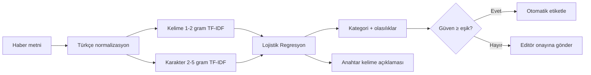

<div align="center">

# 🔎 HaberLens

**Türkçe haber metinleri için açıklanabilir, üretime hazır yapay zekâ sınıflandırıcı**

Bir haberi saniyenin binde birkaçında **7 kategoriden** birine atar,<br>
kararını **hangi kelimelere dayanarak** verdiğini gösterir ve emin olmadığında **editöre haber verir**.

[](https://github.com/kilicchalitt/haberlens/actions/workflows/ci.yml)


[](https://github.com/astral-sh/ruff)
[](LICENSE)

[Hızlı Başlangıç](#-hızlı-başlangıç) •
[Kullanım](#-kullanım) •
[Performans](#-performans) •
[Mimari](docs/ARCHITECTURE.md) •
[API](docs/API.md) •
[Model Kartı](docs/MODEL_CARD.md) •
[English](#-english-summary)

<picture>
  <source media="(prefers-color-scheme: dark)" srcset="docs/assets/web-ui-dark.png">
  
</picture>

</div>

---

## ✨ Neden HaberLens?

Haber siteleri, medya takip ajansları ve kurumsal iletişim ekipleri her gün yüzlerce
haberi elle kategorilere ayırır. HaberLens bu işi otomatikleştirir; ama bir kara kutu
gibi değil, **gerekçesini göstererek**.

| | Özellik | Açıklama |
| :-: | --- | --- |
| 🎯 | **%98,4 makro F1** | Ekonomi, Magazin, Sağlık, Siyaset, Spor, Teknoloji ve Yaşam kategorilerinde 5 katlı çapraz doğrulama ile ölçüldü |
| 💡 | **Açıklanabilir** | Her tahmin, karara en çok katkı veren kelimelerle birlikte gelir (*"merkez bankası", "faiz" → Ekonomi*) |
| 🙋 | **İnsan-döngüde** | Düşük güvenli tahminler `uncertain` olarak işaretlenir ve editör onayına yönlendirilebilir |
| 🇹🇷 | **Türkçeye özgü** | `I/İ` dönüşümü, kesme işaretli ekler (*Fed'in → fed*), karakter n-gramlarıyla ek yapısına dayanıklılık |
| ⚡ | **Hızlı ve hafif** | Tek tahmin ~2 ms, toplu işlemde saniyede ~10.000 haber; GPU gerektirmez, model ~4,5 MB |
| 🔌 | **Her yerden erişim** | Web arayüzü, REST API, komut satırı, CSV toplu işlem ve Python kütüphanesi |
| 🏢 | **Kuruma uyarlanabilir** | Kendi arşivinizle tek komutla yeniden eğitin; sütun adları ve kategoriler esnek |
| 🔒 | **Üretime hazır** | API anahtarı, CORS, istek sınırları, sağlık kontrolü, Docker, CI, %95 test kapsamı |

## 🚀 Hızlı Başlangıç

### Docker ile (önerilen)

```bash
git clone https://github.com/kilicchalitt/haberlens.git
cd haberlens
docker compose up --build
```

Tarayıcıda **http://localhost:8000** adresini açın. API dokümantasyonu: **http://localhost:8000/docs**

### pip ile

```bash
git clone https://github.com/kilicchalitt/haberlens.git
cd haberlens
python -m venv .venv && source .venv/bin/activate   # Windows: .venv\Scripts\activate
pip install -e ".[api]"

haberlens train      # ~30 sn: eğitim + 5 katlı doğrulama → models/haberlens.joblib
haberlens serve      # http://127.0.0.1:8000
```

## 📖 Kullanım

### 1. Web arayüzü

`haberlens serve` komutundan sonra tarayıcıdan metni yapıştırın; kategori, olasılıklar ve
kararı etkileyen kelimeler anında görünür. Açık/koyu tema ve mobil uyumludur.

### 2. Komut satırı

```console
$ haberlens predict "Fenerbahçe deplasmanda Trabzonspor ile berabere kaldı"

📰 Fenerbahçe deplasmanda Trabzonspor ile berabere kaldı
   → Spor  (%99.9)
     Yaşam      %0.0
     Sağlık     %0.0
   Anahtar kelimeler: fenerbahçe, trabzonspor, deplasmanda, kaldı, berabere
```

**Toplu işlem** — bir kurumun günlük haber akışını tek komutla sınıflandırın:

```console
$ haberlens predict --file gunluk_haberler.csv --text-column baslik --output sonuc.csv
1250 metin sınıflandırıldı → sonuc.csv
İnsan onayı önerilen (düşük güvenli) kayıt: 18
```

Çıktı dosyasına `predicted_label`, `confidence` ve `uncertain` sütunları eklenir.
`.txt` (satır başına bir haber) girdi ve `.jsonl` çıktı da desteklenir.

<details>
<summary><b>Tüm komutlar</b></summary>

| Komut | Açıklama |
| --- | --- |
| `haberlens train` | Modeli eğitir, çapraz doğrulama yapar, sürümlü model dosyası üretir |
| `haberlens predict` | Argüman, stdin veya dosyadan gelen metinleri sınıflandırır (`--json` destekli) |
| `haberlens evaluate --data test.csv` | Kayıtlı modeli kurumun kendi etiketli verisiyle ölçer |
| `haberlens info` | Model kartını (mimari, tarih, metrikler) gösterir |
| `haberlens benchmark` | Tüm metin temsili yöntemlerini karşılaştırır |
| `haberlens serve` | REST API ve web arayüzünü başlatır |

</details>

### 3. REST API

```bash
curl -X POST http://localhost:8000/v1/classify \
  -H "Content-Type: application/json" \
  -d '{"text": "Merkez Bankası politika faizini sabit tuttu"}'
```

```json
{
  "label": "Ekonomi",
  "confidence": 0.9799,
  "scores": { "Ekonomi": 0.9799, "Magazin": 0.0055, "Yaşam": 0.0036 },
  "uncertain": false,
  "keywords": [
    { "term": "bankası", "weight": 0.4522 },
    { "term": "merkez", "weight": 0.4136 },
    { "term": "merkez bankası", "weight": 0.3637 }
  ],
  "processing_ms": 2.1
}
```

Toplu sınıflandırma (`/v1/classify/batch`), kimlik doğrulama ve hata kodları için
[API referansına](docs/API.md) bakın.

### 4. Python kütüphanesi

```python
from haberlens import NewsClassifier

clf = NewsClassifier.load("models/haberlens.joblib")

result = clf.predict("Yapay zekâ destekli yeni akıllı telefon tanıtıldı")
print(result.label, result.confidence)            # Teknoloji 0.9999
print([k.term for k in result.keywords])          # ['akıllı', 'yapay', 'yapay zeka', ...]

for r in clf.predict_batch(["Borsa düştü", "Derbi berabere bitti"]):
    print(r.label, r.uncertain)
```

## 🏢 Kurumsal Kullanım Senaryoları

| Kurum | Senaryo |
| --- | --- |
| **Haber siteleri / CMS** | Editör haberi girerken kategori önerisi; yanlış kategoride yayınlanan haberlerin tespiti |
| **Medya takip ajansları** | Günlük binlerce haberi müşteri ilgi alanlarına göre otomatik yönlendirme |
| **Kurumsal iletişim / PR** | Kurum hakkında çıkan haberlerin konu bazlı raporlanması |
| **Arşiv ve kütüphaneler** | Etiketsiz eski haber arşivlerinin toplu etiketlenmesi |
| **Araştırmacılar / öğrenciler** | Türkçe metin sınıflandırma için tekrarlanabilir referans uygulama |

### Kendi verinizle eğitim

Kurumunuzun kendi kategorileri mi var? İki sütunlu herhangi bir CSV yeterli:

```bash
haberlens train --data kurum_arsivi.csv --text-column baslik --label-column kategori
haberlens evaluate --data kurum_test_seti.csv --text-column baslik --label-column kategori
```

## 📊 Performans

Tüm yöntemler aynı veri, aynı 5 katlı katmanlı çapraz doğrulama bölmeleri ve aynı
sınıflandırıcı (Lojistik Regresyon) ile ölçülmüştür. Yeniden üretmek için: `haberlens benchmark`.

<!-- BENCHMARK:START -->
| Sıra | Yöntem | Doğruluk | Makro F1 |
| :-: | --- | :-: | :-: |
| 1 | **HaberLens Hybrid** (kelime + karakter n-gram) | %98,42 | %98,41 ± 0,32 |
| 2 | Karakter n-gram | %98,22 | %98,21 ± 0,32 |
| 3 | TF-IDF | %96,88 | %96,87 ± 0,45 |
| 4 | Bag-of-Words | %95,42 | %95,41 ± 0,43 |
| 5 | Word2Vec (ortalama vektör) | %86,81 | %86,82 ± 0,79 |
| 6 | N-Gram (bigram) | %82,58 | %83,46 ± 1,19 |
<!-- BENCHMARK:END -->

> Dondurulmuş Türkçe BERT gömmeleri `pip install -e ".[embeddings]"` ve
> `haberlens benchmark --include-embeddings` ile aynı tabloya eklenebilir.

Ayrıntılı sonuçlar: [`reports/benchmark.md`](reports/benchmark.md) ·
Sınıf bazlı metrikler ve karışıklık matrisi: [Model Kartı](docs/MODEL_CARD.md)

**Önemli bulgu:** Türkçe sondan eklemeli bir dil olduğu için karakter n-gramları
(*ekonomi / ekonomik / ekonomide*) kelime tabanlı yöntemleri belirgin şekilde geride bırakır.
Kelime ve karakter özniteliklerinin birleşimi hem en yüksek başarıyı hem de okunabilir açıklamaları sağlar.

## 🏗 Mimari



Ön işleme, öznitelik çıkarımı ve sınıflandırıcı tek bir scikit-learn `Pipeline` içinde
yer alır; böylece veri sızıntısı yapısal olarak engellenir ve model tek dosya olarak
sürümlenir. Ayrıntılar ve tasarım kararları: [docs/ARCHITECTURE.md](docs/ARCHITECTURE.md)

## ⚙️ Yapılandırma

Tüm ayarlar ortam değişkenleriyle yapılır (bkz. [`.env.example`](.env.example)):

| Değişken | Varsayılan | Açıklama |
| --- | --- | --- |
| `HABERLENS_MODEL_PATH` | `models/haberlens.joblib` | Yüklenecek model dosyası |
| `HABERLENS_DATA_PATH` | `data/raw/turkish_news.csv` | Varsayılan eğitim verisi |
| `HABERLENS_API_KEY` | *(boş)* | Tanımlanırsa `/v1/*` uç noktaları `X-API-Key` ister |
| `HABERLENS_CORS_ORIGINS` | *(boş)* | Virgülle ayrılmış izinli kaynaklar |
| `HABERLENS_MAX_BATCH_SIZE` | `256` | Toplu istekte en fazla metin sayısı |
| `HABERLENS_MAX_TEXT_LENGTH` | `20000` | Tek metnin en fazla karakter sayısı |

## 📁 Proje Yapısı

```text
haberlens/
├── src/haberlens/
│   ├── preprocessing.py   # Türkçeye özgü metin normalizasyonu
│   ├── data.py            # Veri yükleme, doğrulama, katmanlı bölme
│   ├── pipelines.py       # Model mimarileri (bow, tfidf, bigram, char, hybrid)
│   ├── embeddings.py      # İsteğe bağlı Word2Vec ve BERT
│   ├── training.py        # Eğitim, çapraz doğrulama, model kaydı
│   ├── evaluation.py      # Metrikler ve raporlama
│   ├── artifact.py        # Sürümlü model dosyası + JSON model kartı
│   ├── predictor.py       # NewsClassifier: tahmin, belirsizlik, açıklama
│   ├── benchmark.py       # Yöntem karşılaştırması
│   ├── cli.py             # `haberlens` komut satırı aracı
│   └── api/               # FastAPI uygulaması ve web arayüzü
├── tests/                 # 84 test, %95 kapsam
├── data/raw/              # Veri seti ve veri kartı
├── docs/                  # Mimari, API, model kartı, yol haritası
├── reports/               # Benchmark sonuçları
├── Dockerfile · docker-compose.yml · Makefile · pyproject.toml
└── .github/               # CI, Dependabot, issue/PR şablonları
```

## 🧪 Geliştirme

```bash
make dev        # geliştirme bağımlılıkları
make test       # pytest + kapsam raporu
make lint       # ruff kontrolleri
make help       # tüm komutlar
```

Katkı rehberi için [CONTRIBUTING.md](CONTRIBUTING.md), güvenlik politikası için
[SECURITY.md](SECURITY.md) dosyalarına bakın.

## 🗺 Yol Haritası

- [x] 7 kategori, açıklanabilir hibrit model, CLI, REST API, web arayüzü, Docker, CI
- [ ] Editör geri bildirimi toplama ve periyodik yeniden eğitim
- [ ] Prometheus metrikleri ve hız sınırlama
- [ ] İnce ayarlı Türkçe BERT + ONNX ile hızlı çıkarım
- [ ] Çoklu etiket ve kategori dışı haber tespiti

Ayrıntılar: [docs/ROADMAP.md](docs/ROADMAP.md)

## 📜 Projenin Hikâyesi

HaberLens, ilk NLP projelerimden biri olarak başladı: tek bir Python betiğinde
Bag-of-Words'ten BERT'e beş farklı metin temsilini üç kategori üzerinde karşılaştıran bir
deneydi. v1.0 ile bu deney; veri sızıntısı giderilmiş, test edilmiş, paketlenmiş ve bir
kurumun gerçekten kullanabileceği bir ürüne dönüştü. Değişikliklerin tam listesi için
[CHANGELOG.md](CHANGELOG.md) ve [yol haritası](docs/ROADMAP.md) dosyalarına bakabilirsiniz.

## 🇬🇧 English Summary

**HaberLens** is a production-ready, explainable news classifier for Turkish. It assigns
news headlines and short articles to seven categories (Economy, Celebrity, Health,
Politics, Sports, Technology, Life/Incidents) with **98.4% macro-F1** (5-fold CV), explains
each decision with the most influential keywords, and flags low-confidence predictions for
human review. It ships as a Python library, CLI (including bulk CSV processing), FastAPI
REST service with optional API-key auth, and a zero-dependency web UI, packaged with
Docker and tested in CI across Python 3.10–3.13. A reproducible benchmark compares
Bag-of-Words, TF-IDF, word/character n-grams and Word2Vec, with optional frozen Turkish BERT.

Developed and maintained by **Halit Kılıç** ([@kilicchalitt](https://github.com/kilicchalitt)).

## 👤 Geliştirici

**Halit Kılıç** · Doğal Dil İşleme · Makine Öğrenmesi · Python

[](https://github.com/kilicchalitt)

HaberLens, Halit Kılıç tarafından geliştirilmekte ve sürdürülmektedir.

| Konu | Kanal |
| --- | --- |
| Hata bildirimi ve özellik önerisi | [GitHub Issues](https://github.com/kilicchalitt/haberlens/issues/new/choose) |
| Güvenlik açığı bildirimi | [Güvenlik politikası](SECURITY.md) |
| Katkıda bulunma | [Katkı rehberi](CONTRIBUTING.md) |

Projeyi faydalı bulduysanız ⭐ vererek destek olabilirsiniz.

## 📄 Lisans ve Atıf

[MIT](LICENSE) lisansı ile dağıtılmaktadır. © 2026 Halit Kılıç.
Akademik çalışmalarda atıf için [`CITATION.cff`](CITATION.cff) dosyasını kullanabilirsiniz
(GitHub'daki *"Cite this repository"* butonu).
