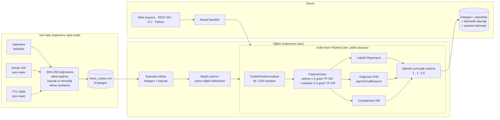

# Mimari

## Genel bakış



## Modüller

| Modül | Sorumluluk |
| --- | --- |
| `config.py` | `HABERLENS_*` ortam değişkenlerinden okunan çalışma zamanı ayarları |
| `corpus.py` | Kaynakları indirme, doğrulama, etiket eşleme, temizlik, tekrar ayıklama, manifesto |
| `preprocessing.py` | Türkçe büyük/küçük harf, kesme işareti ekleri, URL/sayı/noktalama temizliği, etkisiz sözcükler, metin kesme |
| `data.py` | CSV okuma, şema doğrulama, kaynak sütunu, kategori × kaynak katmanlı bölme |
| `pipelines.py` | Kayıtlı mimariler: `bow`, `tfidf`, `bigram`, `char`, `hybrid`, `svm`, `nb`, `ensemble` |
| `training.py` | Başlık artırımı, sızıntısız çapraz doğrulama, test değerlendirmesi, kayıt |
| `evaluation.py` | Doğruluk, makro F1, ilk-2 doğruluk, kaynak bazlı ve başlık performansı, karışıklık matrisi |
| `artifact.py` | Sürümlü model dosyası (`.joblib`) ve JSON model kartı |
| `predictor.py` | `NewsClassifier`: tekil/toplu tahmin, belirsizlik, açıklama |
| `benchmark.py` | Ayrılmış test ve görülmemiş kaynak (leave-one-source-out) karşılaştırması |
| `embeddings.py` | İsteğe bağlı Word2Vec temsili (yalnızca benchmark) |
| `cli.py` | `haberlens` komut satırı arayüzü |
| `api/` | FastAPI uygulaması, şemalar ve web arayüzü |

## Tasarım kararları

Her kararın arkasındaki ölçümler [`EXPERIMENTS.md`](EXPERIMENTS.md) belgesindedir.

### Neden çok kaynaklı veri?

Tek bir veri setiyle eğitilen model o kaynağın üslubunu ezberler: v1.0 modeli kendi test
bölmesinde %98,5 makro F1 verirken hiç görmediği bir yayın organının haberlerinde %76,5'e
düşüyordu. Farklı sitelerden, yıllardan ve uzunluklardan haberleri birleştirmek modelin
konuyu öğrenmesini, kaynağı ezberlememesini sağlar. Kaynak adları ve ajans imzaları bu
yüzden derlemden temizlenir.

### Neden tek bir `Pipeline`?

Ön işleme, öznitelik çıkarımı ve sınıflandırıcının tek bir `Pipeline` içinde olması:

- veri sızıntısını yapısal olarak imkânsız kılar (vektörleştirici yalnızca eğitim
  verisini görür),
- eğitim ve tahminde birebir aynı ön işlemeyi garanti eder (*training/serving skew* yok),
- modelin tek dosya olarak sürümlenmesini ve dağıtılmasını sağlar.

### Neden kelime + karakter n-gram?

Türkçe sondan eklemeli bir dildir: *ekonomi, ekonomik, ekonomide, ekonominin* farklı
kelimeler olarak sayılır. Karakter n-gramları bu biçimleri ortak alt dizgiler üzerinden
eşleştirir; ek bir kök bulucuya (stemmer) gerek kalmaz. Kelime n-gramları ise
*"merkez bankası"* gibi okunabilir ifadeler sağlayarak açıklamaları anlamlı kılar.

### Neden üç modelin topluluğu?

Lojistik Regresyon, Doğrusal SVM ve Naive Bayes aynı öznitelikler üzerinde farklı
varsayımlarla çalışır ve farklı hatalar yapar. Aynı dağılımdaki testte topluluk tek
modellerle aynı düzeydedir; **görülmemiş kaynakta** ise Lojistik Regresyondan 4 puandan
fazla iyidir. Kurumların modeli kendi (eğitimde görülmemiş) haberlerine uygulayacağı
düşünüldüğünde belirleyici ölçüt budur.

- **Lojistik Regresyon:** iyi kalibre olasılıklar ve açıklamalar için doğrusal ağırlıklar
- **Doğrusal SVM:** seyrek, yüksek boyutlu metinde güçlü karar sınırı; sigmoid
  kalibrasyonla olasılığa dönüştürülür
- **Complement Naive Bayes:** dengesiz sınıflarda sağlam, farklı tümevarımsal varsayım

### Neden başlık artırımı?

Derlemin büyük kısmı tam metin, kullanıcı girdilerinin çoğu ise başlıktır. Haber metinleri
başlıkla başladığı için her uzun eğitim haberinin ilk 12 kelimesi ek örnek olarak eklenir.
Bu, görülmemiş kaynağın başlıklarında makro F1'i 4,4 puan artırır. Artırım yalnızca eğitim
bölümüne uygulanır; test verisine asla dokunulmaz.

### Neden BERT yok?

İnce ayarlı bir Türkçe transformer muhtemelen daha yüksek doğruluk verir; ancak ~400 MB
ağırlık, PyTorch bağımlılığı ve GPU'suz ortamlarda çok daha yavaş çıkarım getirir.
Ağırlıklar Hugging Face Hub'dan indirilmelidir ve bu sürümün geliştirildiği ortamda Hub'a
erişim yoktu; doğrulanamayan bir model eklenmedi. Yol haritasında yer almaktadır.

## Model dosyası biçimi

```text
models/
├── haberlens.joblib   # {"format_version", "pipeline", "labels", "metadata"}
└── haberlens.json     # metadata: eğitim zamanı, veri SHA-256, metrikler, sürümler
```

`format_version` uyumsuz bir modeli yüklemeye çalışmak açık bir hata mesajıyla
sonuçlanır; sessizce yanlış tahmin üretilmez.
