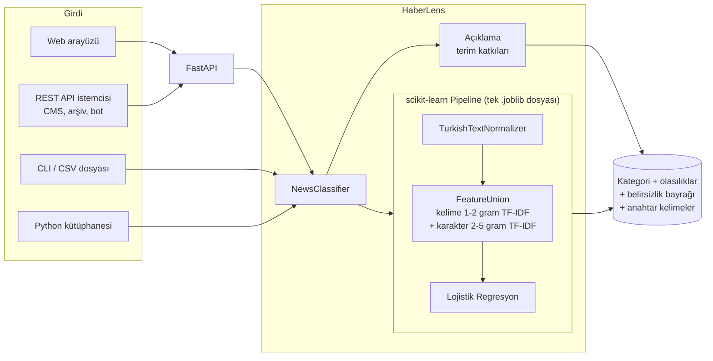

# Mimari

## Genel bakış



## Modüller

| Modül | Sorumluluk |
| --- | --- |
| `config.py` | `HABERLENS_*` ortam değişkenlerinden okunan çalışma zamanı ayarları |
| `preprocessing.py` | Türkçe büyük/küçük harf, kesme işareti ekleri, URL/sayı/noktalama temizliği, etkisiz sözcükler |
| `data.py` | CSV okuma, şema doğrulama, tekrar ayıklama, katmanlı bölme |
| `pipelines.py` | Kayıtlı model mimarileri (`bow`, `tfidf`, `bigram`, `char`, `hybrid`) |
| `embeddings.py` | İsteğe bağlı Word2Vec ve BERT dönüştürücüleri (yalnızca benchmark) |
| `training.py` | Çapraz doğrulama, test değerlendirmesi, tüm veriyle yeniden eğitim, kayıt |
| `evaluation.py` | Doğruluk, makro/ağırlıklı F1, sınıf bazlı rapor, karışıklık matrisi |
| `artifact.py` | Sürümlü model dosyası (`.joblib`) ve JSON model kartı |
| `predictor.py` | `NewsClassifier`: tekil/toplu tahmin, belirsizlik, açıklama |
| `benchmark.py` | Yöntemlerin aynı koşullarda karşılaştırılması ve raporlanması |
| `cli.py` | `haberlens` komut satırı arayüzü |
| `api/` | FastAPI uygulaması, şemalar ve web arayüzü |

## Tasarım kararları

### Neden tek bir `Pipeline`?

Orijinal betikte vektörleştiriciler veri bölünmeden **önce** tüm veriyle eğitiliyordu;
bu, test kümesinin kelime dağarcığının eğitime sızması (data leakage) demektir. Ön işleme,
öznitelik çıkarımı ve sınıflandırıcının tek bir `Pipeline` içinde olması:

- sızıntıyı yapısal olarak imkânsız kılar,
- eğitim ve tahminde birebir aynı ön işlemeyi garanti eder (*training/serving skew* yok),
- modelin tek dosya olarak sürümlenmesini ve dağıtılmasını sağlar.

### Neden kelime + karakter n-gram?

Türkçe sondan eklemeli bir dildir: *ekonomi, ekonomik, ekonomide, ekonominin* farklı
kelimeler olarak sayılır. Karakter n-gramları bu biçimleri ortak alt dizgiler üzerinden
eşleştirir; ek bir kök bulucuya (stemmer) gerek kalmaz. Kelime n-gramları ise
*"merkez bankası"* gibi okunabilir ifadeler sağlayarak açıklamaları anlamlı kılar.
Benchmark sonuçları ([`reports/benchmark.md`](../reports/benchmark.md)) bu birleşimin
tek başına her iki yöntemden de daha iyi olduğunu gösterir.

### Neden Lojistik Regresyon?

- Kalibre edilmiş olasılıklar üretir → güven skoru ve *belirsiz* bayrağı anlamlıdır.
- Doğrusal ağırlıklar her kararın hangi terimlerden kaynaklandığını açıklamayı sağlar.
- CPU üzerinde milisaniyeler içinde tahmin yapar; GPU gerektirmez.

### Neden BERT varsayılan değil?

Hibrit model bu veri setinde %98,4 makro F1'e ulaşırken ~4,5 MB boyutunda ve CPU'da
milisaniyeler içinde çalışır. BERT tabanlı bir model ise ~400 MB ağırlık, PyTorch
bağımlılığı ve çok daha yüksek çıkarım maliyeti getirir; kalan ~%1,5'lik hata payı için
bu maliyet çoğu kurum için gerekçelendirilemez. Dondurulmuş BERT gömmeleri
`haberlens benchmark --include-embeddings` ile aynı koşullarda karşılaştırılabilir;
BERT'in ince ayarlanması (fine-tuning) ve ONNX ile hızlandırılması yol haritasında yer almaktadır.

## Model dosyası biçimi

```text
models/
├── haberlens.joblib   # {"format_version", "pipeline", "labels", "metadata"}
└── haberlens.json     # metadata: eğitim zamanı, veri SHA-256, metrikler, sürümler
```

`format_version` uyumsuz bir modeli yüklemeye çalışmak açık bir hata mesajıyla
sonuçlanır; sessizce yanlış tahmin üretilmez.
